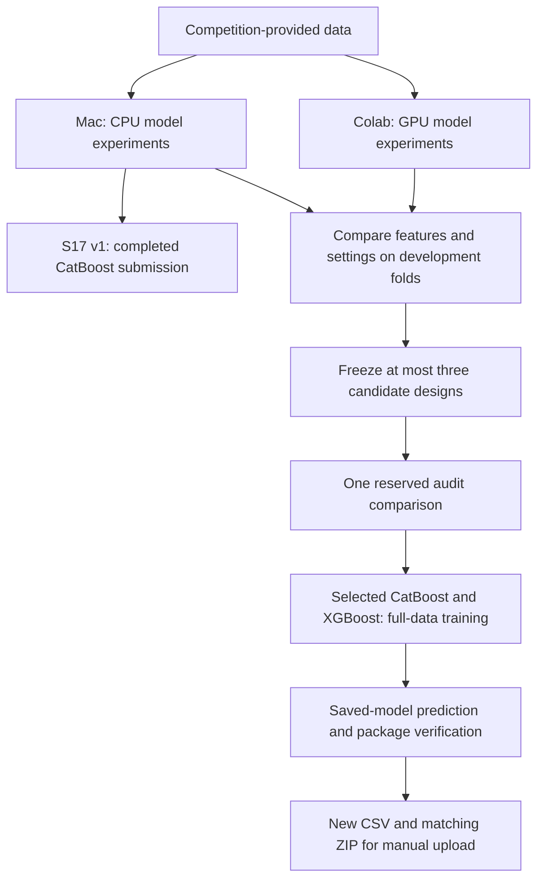

# How the submission is produced

[[00 Dashboard]] · [[03 Experiments]] · [[04 Submission Tracker]]

**A submission can be complete while other experiments are still running.** S17 v1 came from a finished five-fold CatBoost run on the Mac. Colab was running separate GPU comparisons. The visible Colab cell was not the job that produced S17 v1.

S17 v1's training took **1,049.59 seconds — about 17½ minutes**. Its file contains a complete prediction for each of the 61,500 test applicants. All five folds contributed; saved-model inference reproduced the CSV exactly. It was called an interim candidate because model selection was still in progress. It was not a partly filled or partly trained submission. Ryo submitted it and received public AUC **0.76365**.

## Why comparison takes longer

One fold fits one model to a training subset and scores it on rows excluded from that fit. A five-fold run repeats this five times. Each trained fold also predicts every test row; averaging those five predictions produces one complete model-family submission.

Tuning repeats fitting with different settings. The sprint searched **40 LightGBM, 20 GPU CatBoost and 8 XGBoost trials**, usually using three development folds per trial and stopping unpromising trials early. Promising models then received five-fold confirmation, feature comparisons and second-seed checks. These repeated fits account for most of the experiment time.

## The new signals we tested

| Derived feature | What it expresses | What the experiment showed |
| --- | --- | --- |
| Affordability ratios | Credit and payments relative to income and household size | Useful; retained in both selected models |
| Peer profiles | How an applicant differs from comparable groups in the training fold | Used with pricing features in XGBoost |
| Pricing scenarios | Rates implied by credit and annuity under hypothetical repayment terms | XGBoost AUC improved from 0.758902 to 0.761092 before extra tuning; second seed supported the improvement |
| Category combinations | Relationships such as occupation × organization or housing × family status | Did not improve the tested LightGBM/GPU CatBoost candidates; excluded |
| Enquiry-window comparisons | Relative credit-enquiry intensity across supplied time windows | Did not improve the tested LightGBM comparison; excluded |

These features expose patterns in existing information. They do not recreate unavailable monthly payment records, actual contract duration, or observed interest rates. Hypothetical pricing values are explicitly labelled as hypotheses in the code. Group statistics are learned within each training fold; validation and audit labels do not contribute to them.

## How the final choice was made

The 171,202 labelled rows were split into **136,961 development rows** and **34,241 reserved audit rows**. The audit was excluded from feature selection, tuning and early stopping. Three candidate designs and their exact component hashes were frozen before it was scored.

The one audit comparison selected an equal CatBoost/XGBoost blend at **0.764923 AUC**, slightly above the three-model blend's 0.764597. The difference is small and may not persist on the leaderboard. The selected CatBoost uses affordability features; the selected XGBoost uses affordability, peer and pricing features.

Final training makes all 171,202 labels eligible across five folds. Each fold still holds out its own validation rows, so each individual fitted model sees four-fifths of that population. The complete labelled dataset participates across the ensemble. This final-training CV is no longer an independent audit result.

## What reliability means here

File reliability is checked directly: exact test IDs and order, 61,500 finite probabilities in [0,1], predictions reproduced from saved models, and a ZIP containing the exact CSV and executed code/configuration. These checks make a submission complete and reproducible.

Predictive reliability is less certain: development folds, a second seed and the reserved audit provide evidence, while public and final leaderboard scores come from different held-out rows. A later submission is not guaranteed to score higher. **No result so far demonstrates the target of 0.80 AUC.**

The competition metric is ROC AUC, a ranking measure. It is not the percentage of applicants classified correctly at a particular probability threshold. Public AUC, development AUC and audit AUC should always be recorded separately.
